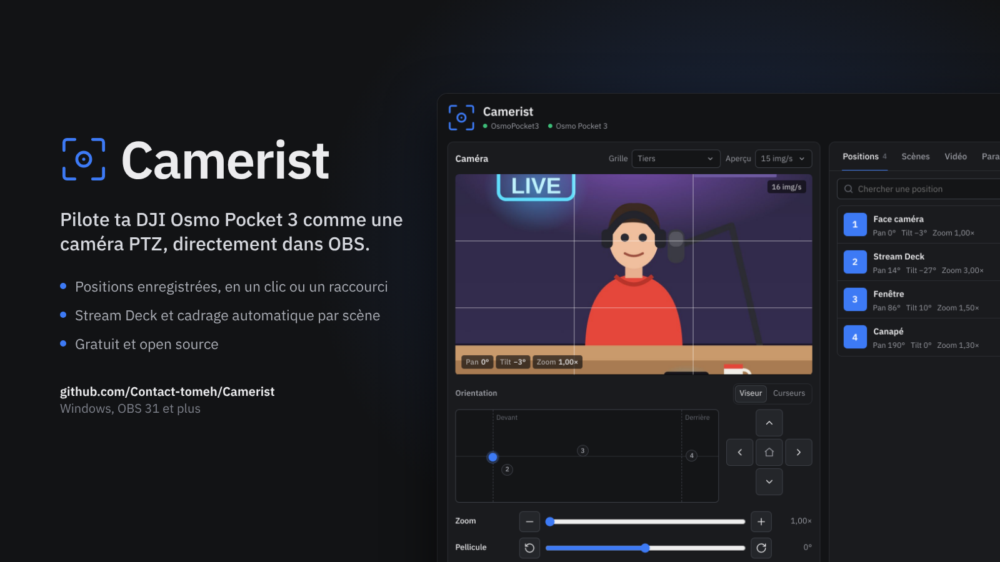
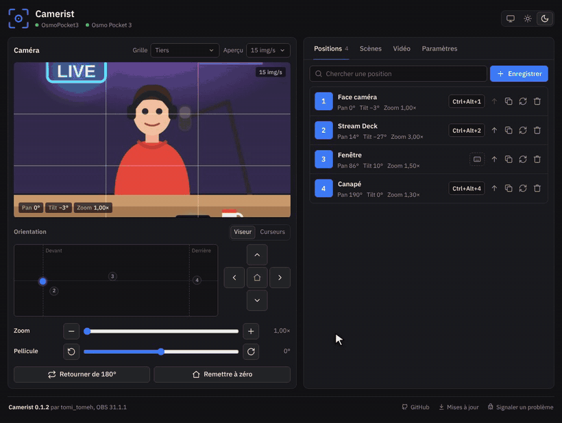

# Camerist

**Transforme une caméra USB avec nacelle en caméra PTZ, directement dans OBS Studio.**

Camerist est un plugin OBS pensé pour la DJI Osmo Pocket 3 en mode webcam. Il marche aussi avec toute caméra USB qui expose des commandes de panoramique, d'inclinaison ou de zoom à Windows. Il ajoute un dock **Camerist** à OBS pour orienter la caméra, zoomer, enregistrer des positions et les rappeler d'un clic, d'un raccourci, d'un bouton de Stream Deck ou au changement de scène.

[English version](README.md)

Démo enregistrée avec une caméra simulée et une pièce dessinée.

## Ce que ça fait

- Aperçu de la source caméra, avec grilles de cadrage (tiers, quadrillage, croix centrale, diagonales, zones de sécurité)
- Viseur cliquable (clique pour viser, glisse pour suivre) ou curseurs classiques pour le panoramique, l'inclinaison, la pellicule et le zoom
- Positions enregistrées, avec trajet doux ou direct, recherche et réorganisation
- Un raccourci OBS par position, plus remise à zéro, retourner de 180°, zoomer et dézoomer (visibles aussi dans Paramètres d'OBS, Raccourcis clavier)
- Positions liées aux scènes : quand OBS change de scène, la caméra va à la position choisie
- Stream Deck avec de simples adresses web
- Tous les réglages de la source caméra au même endroit : résolution, FPS, format vidéo, espace et gamme de couleurs YUV, mémoire tampon, retournement, rotation, décodage matériel
- Thème clair, sombre ou automatique, six couleurs d'accent
- Anglais et français, selon la langue d'OBS

La vidéo reste dans OBS : Camerist envoie seulement des ordres de mouvement à la caméra, comme les curseurs de la fenêtre « Configurer la vidéo » de la source.

## Installation

1. Ferme OBS.
2. Télécharge `camerist-x.y.z-windows-x64-Installer.exe` sur la page [Releases](../../releases) et lance-le. Windows demande les droits administrateur, parce que les plugins d'OBS sont dans un dossier partagé.
3. Branche la caméra en USB, mets-la en mode webcam et ajoute-la dans OBS en source **Périphérique de capture vidéo**.
4. Lance OBS. Le dock **Camerist** apparaît tout seul (sinon, ouvre le menu **Docks** et coche-le).

L'installateur place le plugin dans `C:\ProgramData\obs-studio\plugins\camerist`, le dossier où OBS va chercher ses plugins, donc ça marche quel que soit l'endroit où OBS est installé. Pour le désinstaller : Paramètres de Windows, Applications, comme n'importe quel logiciel. Tes positions et réglages restent dans `%APPDATA%\obs-studio\plugin_config\camerist`.

Tu préfères installer à la main ? Télécharge le `.zip` et décompresse-le dans `C:\ProgramData\obs-studio\plugins`.

Il faut OBS Studio 31 ou plus récent, sous Windows 10 ou 11.

## Caméras compatibles

Voir le [tableau dans le README anglais](README.md#compatible-cameras). Pour vérifier une caméra : propriétés de la source dans OBS, « Configurer la vidéo », onglet « Contrôle de la caméra ». Si les curseurs Panoramique, Inclinaison ou Zoom sont actifs, Camerist pourra la piloter.

## Stream Deck

Action **Système > Site web**, coche **Accès en arrière-plan** et colle une adresse (liste complète dans le dock, onglet Paramètres). Pour une position, utilise le bouton de copie à côté d'elle.

## Support

Un bug, une idée, une autre caméra testée ? [Ouvre un ticket](https://github.com/Contact-tomeh/camerist/issues/new/choose), en français ou en anglais. Le dock a un lien **Signaler un problème** tout en bas.

Pour un problème de sécurité, signale-le en privé : voir [SECURITY.md](SECURITY.md).

Les adresses du Stream Deck sont les mêmes pour tout le monde et ne marchent que sur ton propre ordinateur : les partager ne pose aucun risque.

## Crédits

Fait par [Contact-tomeh](https://github.com/Contact-tomeh), avec l'aide de [Claude](https://claude.ai) d'Anthropic.

## Licence

GPL-2.0 ou ultérieure, comme OBS Studio.
