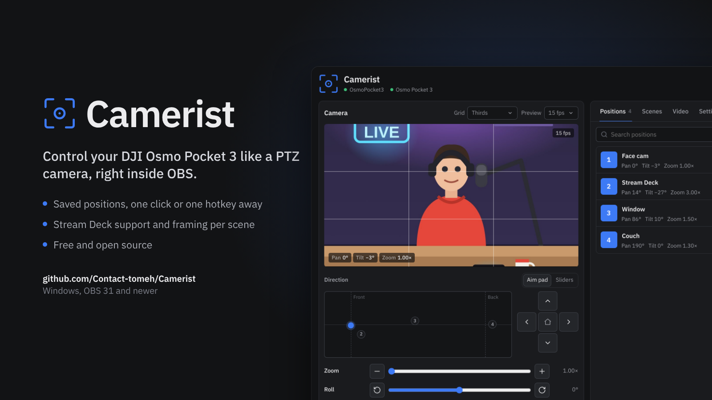
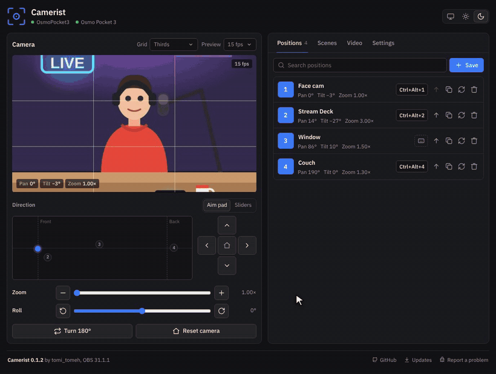

# Camerist

**Turn a USB camera with a gimbal into a PTZ camera, right inside OBS Studio.**

Camerist is an OBS plugin made for the DJI Osmo Pocket 3 in webcam mode, and it works with any USB camera that exposes pan, tilt or zoom controls to Windows. It adds a **Camerist** dock to OBS where you can aim the camera, zoom, save positions and recall them with a click, a hotkey, a Stream Deck button or a scene change.

[Version française](README.fr.md)

Demo recorded with a simulated camera and a drawn room.

## Features

- Live preview of the camera source, with framing grids (thirds, 4×4, center cross, diagonals, safe areas)
- Aim pad (click to aim, drag to follow) or classic sliders for pan, tilt, roll and zoom
- Saved positions with smooth or instant moves, a travel time per position, search, reordering
- Tours: the camera goes through the positions you pick, in your order, with a pause on each one, once or on a loop
- One OBS hotkey per position and per tour, plus next and previous position, stop the tour, reset, turn 180°, zoom in and zoom out (also listed in OBS Settings, Hotkeys)
- Positions or tours linked to scenes: when OBS switches scene, the camera moves to its position or starts its tour
- Stream Deck support through simple web addresses
- All the camera source settings in one place: resolution, FPS, video format, YUV color space and range, buffering, flip, rotation, hardware decoding
- Light, dark or automatic theme, six accent colors
- English and French, following the OBS language
- A discreet notice when a new version is out, with a link to its release page

The video stays in OBS: Camerist only sends movement commands to the camera, the same way as the sliders in the source's "Configure Video" window.

## Installation

1. Close OBS.
2. Download `camerist-x.y.z-windows-x64-Installer.exe` from the [Releases](../../releases) page and run it. Windows asks for administrator rights because OBS plugins live in a shared folder.
3. Plug the camera in over USB, switch it to webcam mode and add it to OBS as a **Video Capture Device** source.
4. Start OBS. The **Camerist** dock appears on its own (otherwise open the **Docks** menu and tick it).

The installer puts the plugin in `C:\ProgramData\obs-studio\plugins\camerist`, the folder OBS loads plugins from, so it works wherever OBS itself is installed. Uninstall it from Windows Settings, Apps, like any program. Your positions and settings are kept in `%APPDATA%\obs-studio\plugin_config\camerist`.

Prefer a manual install? Download the `.zip` instead and extract it into `C:\ProgramData\obs-studio\plugins`.

Requirements: OBS Studio 31 or newer on Windows 10 or 11.

## Compatible cameras

Camerist works with any USB camera whose Pan, Tilt or Zoom sliders are active in OBS: source properties, "Configure Video", "Camera Control" tab.

| Camera | Status |
| --- | --- |
| DJI Osmo Pocket 3 | Tested: pan, tilt, roll, zoom |
| DJI Osmo Pocket 4 / 4P | Should work (same USB controls according to other projects), to be confirmed |
| USB PTZ cameras (OBSBOT Tiny, Insta360 Link, Logitech PTZ Pro…) | Should work if they expose these controls to Windows, to be confirmed |
| Webcams with zoom only | Only zoom is available |
| Fixed webcams | No movement. Preview and video settings still work |

Tested another camera? Please open an issue so it can be added to this list.

## Stream Deck

Add a **System > Website** action, tick **Access in background** and paste one of these addresses:

| Action | Address |
| --- | --- |
| Go to a position | copy button next to the position in the dock |
| Next / previous position | `http://127.0.0.1:8765/api/next` and `/api/prev` |
| Start or stop a tour | copy button next to the tour in the dock |
| Stop the tour | `http://127.0.0.1:8765/api/tour/stop` |
| Reset camera | `http://127.0.0.1:8765/api/home` |
| Turn 180° | `http://127.0.0.1:8765/api/flip` |
| Zoom in / out | `http://127.0.0.1:8765/api/zoom/in` and `/api/zoom/out` |
| Small step on an axis | `http://127.0.0.1:8765/api/nudge?axis=pan&delta=5` |

Axes are `pan`, `tilt`, `roll` and `zoom`. Add `?d=0` to a position address to jump there without travel, or `?d=3` for a 3 second move. Every action is also an OBS hotkey, so tools that trigger OBS hotkeys work too. Any manual move (arrows, positions, zoom) stops the tour that is running.

The local server only listens on `127.0.0.1`, it cannot be reached from another computer.

## Support

Found a bug, have an idea, or tested another camera? [Open an issue](https://github.com/Contact-tomeh/camerist/issues/new/choose), in English or French. The dock has a **Report a problem** link at the bottom.

For security problems, please report them privately: see [SECURITY.md](SECURITY.md).

The Stream Deck addresses are the same for everyone and only work on your own computer, so sharing them is harmless.

## Translations

The dock follows the OBS language. Texts live in two places:

- `data/locale/*.ini` for the names shown in OBS (dock title, hotkeys)
- the `I18N` block at the top of the script in `data/web/index.html` for the dock itself

To add a language, copy the `en` entries, translate them and open a pull request.

## Building

Every push to GitHub builds the plugin automatically (GitHub Actions, see `.github/workflows`). The build produces the Windows installer and a `.zip`, available for 90 days in the **Artifacts** section of the run. GitHub always wraps artifacts in a zip: open it to get the installer.

To publish a version: on GitHub, go to **Releases**, **Draft a new release**, create a tag such as `0.1.0` and publish. The build runs again and attaches the installer to the release, ready to download.

To build locally, follow the instructions of the [OBS plugin template](https://github.com/obsproject/obs-plugintemplate), which this project is based on. The installer needs [Inno Setup 6](https://jrsoftware.org/isinfo.php).

## Support the project

Camerist is free and will stay free. If it helps your streams, you can support its development:

Ko-fi is for one-off donations, Liberapay for regular ones.

## Credits

Made by [Contact-tomeh](https://github.com/Contact-tomeh), with the help of [Claude](https://claude.ai) by Anthropic.

## License

GPL-2.0-or-later, like OBS Studio. Includes [cpp-httplib](https://github.com/yhirose/cpp-httplib) (MIT).
